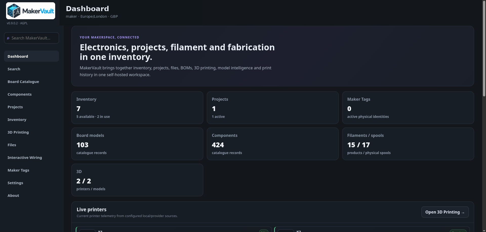

<p align="center">
  
</p>

<h1 align="center">MakerVault User Guide</h1>

<p align="center">
  The user guide for <strong>MakerVault v1.7.0</strong> — a self-hosted workspace for maker projects, electronics inventory and 3D printing.
</p>

<p align="center">
  <a href="https://gavrd7.github.io/MakerVault-docs/">Read the guide</a> ·
  <a href="https://github.com/gavrd7/MakerVault">MakerVault application</a> ·
  <a href="docs/guide/getting-started/install.md">Installation instructions</a>
</p>

## What is MakerVault?

**MakerVault** brings project planning, inventory, technical files and 3D-printing workflows together in one browser-based workshop application. It runs on your own server so your project records, files, print history and stock information remain with your installation.

You can manage electronic boards and components, create projects and bills of materials, organise model revisions, record printers and filament, and link physical workshop items to their records using **MakerTags**.

<p align="center">
  
</p>

<p align="center"><em>Projects, inventory, printing and workshop activity in one dashboard.</em></p>

## What MakerVault includes

| Area | What you can do |
| --- | --- |
| **Projects and electronics** | Organise projects, boards, components, physical inventory, BOM allocations, technical files and wiring diagrams. |
| **3D printing** | Manage printers, filament, physical/reusable spools, models, print history and printed parts. Monitor supported printers and camera feeds. |
| **MakerVault Slicer** | Prepare STL/3MF models and slice with independently installed **OrcaSlicer, Creality Print or Bambu Studio**. Use compatible native profiles, object settings, material painting, supports and other engine-supported tools, then review G-code before printing. |
| **G-code Library** | Keep private G-code files, inspect their metadata and preview, browse supported printer files, and explicitly upload or start compatible jobs. |
| **MakerTags and connected devices** | Generate QR/NFC identifiers, link physical items to records and use a paired RFID/NFC terminal for supported tag workflows. |
| **Accounts and administration** | Manage users, permissions, secure sign-in options, HTTPS, integrations, storage, backups and restoration. |

Native slicer-engine compatibility varies by engine, profile, printer and firmware. Slicing and printer submission are separate actions: MakerVault does not automatically start a print just because G-code was generated.

## Install MakerVault

MakerVault uses **one Docker Compose file** and published container images. Its normal deployment contains four containers: MakerVault, a separate MakerVault Slicer container, PostgreSQL and Redis. Only the application’s user-facing ports are published; the other services communicate over the internal MakerVault network.

For a new Linux installation, follow the [step-by-step installation guide](docs/guide/getting-started/install.md), then [configure your server](docs/guide/getting-started/environment.md) and complete the first-run wizard. For a Windows host, use the [Docker Desktop / WSL2 guide](docs/guide/getting-started/windows.md).

The following chapters explain specific tasks in more detail:

- [Choose persistent storage](docs/guide/getting-started/storage.md) — Docker volumes or custom host folders for application data and installed slicer engines.
- [Set up MakerVault Slicer](docs/guide/slicer/installation.md) — native engine installation, versions and the separate slicer container.
- [Install and select slicing profiles](docs/guide/slicer/engines.md) — compatible native printer, process and filament profiles.
- [Prepare, paint and slice](docs/guide/slicer/workbench.md) — build plates, materials, painting and G-code review.
- [Update MakerVault](docs/guide/administration/updates.md) — preserve data, keys, installed engines and profiles.
- [Back up and restore](docs/guide/administration/backup.md) — safeguard your installation before major changes.

## Using the guide

The published guide at **https://gavrd7.github.io/MakerVault-docs/** is arranged by task rather than by historical release. Start with [installation](docs/guide/getting-started/install.md), then use the relevant chapters for [3D Printing](docs/guide/using/printing.md), [models](docs/guide/using/models.md), [G-code and print submission](docs/guide/using/gcode-and-print-submission.md), [MakerTags](docs/guide/using/maker-tags.md), [connected devices](docs/guide/using/connected-devices.md) and [terminal interoperability](docs/guide/using/terminal-interoperability.md).

The application and documentation have separate repositories:

| Repository | Purpose |
| --- | --- |
| [MakerVault](https://github.com/gavrd7/MakerVault) | Application source, Docker deployment, issue tracking and releases |
| [MakerVault-docs](https://github.com/gavrd7/MakerVault-docs) | This public guide, screenshots and GitHub Pages |
| [MakerVault-Hardware](https://github.com/gavrd7/MakerVault-Hardware) | Companion hardware, firmware and printable enclosures |

For a version-by-version change history, see the [MakerVault Releases page](https://github.com/gavrd7/MakerVault/releases), rather than treating earlier release notes as separate installation instructions.

## Development and validation

MakerVault is an **AI-coded project**, developed through AI tooling under human product direction and practical acceptance testing. The maintainer defines the features and design, performs hardware checks and evaluates the resulting implementation. Automated tests and native slicer fixtures support that process, but they do not establish universal physical-printer compatibility.

Documentation screenshots are sanitised to avoid exposing addresses, credentials and private project data. Real screenshots supplement the steps rather than replace them.

## Contributing to the guide

The guide source lives in `docs/guide/`, with MkDocs navigation in `mkdocs.yml`. To validate documentation changes locally:

```bash
python3 -m venv .venv
. .venv/bin/activate
python -m pip install -r docs/requirements.txt
python -m mkdocs build --strict
python scripts/check_guide_links.py
```

See [Guide maintenance](docs/GUIDE_MAINTENANCE.md) for publishing and screenshots.

## Licence, support and contact

MakerVault software is licensed **AGPL-3.0-or-later** in the application repository. Third-party media retains its original licence and attribution.

- **General enquiries:** [maker@makervault.co.uk](mailto:maker@makervault.co.uk)
- **Hardware and manufacturer partnerships:** [partnerships@makervault.co.uk](mailto:partnerships@makervault.co.uk)
- **Support:** [support@makervault.co.uk](mailto:support@makervault.co.uk)

For bugs and feature requests use [MakerVault issues](https://github.com/gavrd7/MakerVault/issues/new/choose). Report security concerns privately according to [SECURITY.md](https://github.com/gavrd7/MakerVault/blob/main/SECURITY.md).
