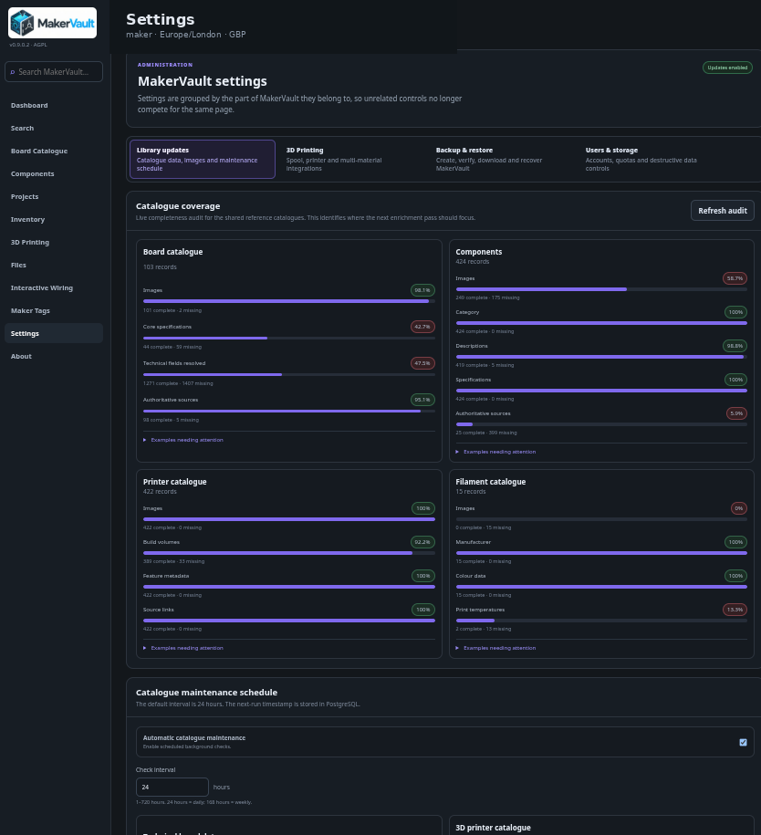

# Catalogue updates

**Goal:** keep reference data and images fresh without daily manual work.

1. Open **Settings → Library updates** as an administrator.
2. Review whether automatic maintenance is enabled.
3. Choose the interval; the default is **24 hours**.
4. Select the available board/component, printer, filament and image checks you want.
5. Choose **Save schedule**.
6. Use **Run now** for an immediate queued check and review the last/next run information.

The schedule is stored in PostgreSQL and survives container rebuilds. Background workers perform the work, so queueing a run is not the same as completing it. External sources, retry intervals and per-run limits affect how quickly gaps are filled.

Printer catalogue maintenance uses OrcaSlicer for broad profile-backed coverage and merges MakerVault supplemental FDM/FFF entries for known printers that Orca omits. Supplemental records never remove local models and do not imply live-monitoring support.

Enrichment is designed to preserve populated information rather than overwrite edits just because another source supplies a value. Filament maintenance can refresh missing catalogue fields and consult authoritative manufacturer product/TDS data for density, nozzle/bed temperatures and drying guidance. The filament catalogue combines SpoolmanDB with verified supplemental records for genuine gaps, and retains provenance. Unsupported models, intentionally unmatched filaments or unavailable reliable sources can remain incomplete indefinitely.

## Server-level controls

`.env` contains master switches such as `ENRICH_BOARD_CATALOGUE` and `SEED_CATALOGUE_IMAGES`. A UI schedule cannot override a server-level hard disable. Check those values if a category never runs.

If nothing runs, inspect the application logs and container health. Celery worker and Beat run inside the application container in this deployment; you do not need to create separate worker services for the standard Compose setup.

[Troubleshooting →](../reference/troubleshooting.md)

<figure markdown>
  
  <figcaption>Library updates report catalogue coverage and control scheduled maintenance.</figcaption>
</figure>

## Reusable spool catalogue upkeep and review

The existing library update schedule can check reusable spool source links and attempt conservative image enrichment. Unknown technical data remains unknown; source availability alone is not evidence that a measurement is correct. The catalogue coverage summary reports source, hardware data, image and dryer-limit availability.

From **3D Printing → Reusable spools → Browse manufacturer catalogue**, administrators with catalogue editing permission can open **Review Suggestions** to see non-admin submissions for new spool models or corrections, review the source URLs and changed fields, then choose **Approve** or **Reject**. Processed submissions disappear from this pending-only modal but their records remain. An administrator submitting a new model or correction has it accepted immediately; this is workflow approval, not a manufacturer-verification claim. 
