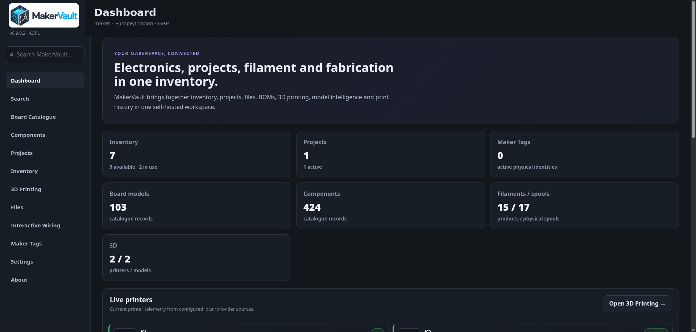

MakerVault / User guide

# Your workshop, organised.

Learn to install MakerVault, record what you own and bring your projects, files and 3D printing together. Start with one project. Add the rest when you need it.

[Start here](getting-started/before-you-begin.md){ .md-button .md-button--primary }
[Follow the guided workflow](getting-started/first-project.md){ .md-button }

**Introduced in v1.5.1 / Terminal v1.0.1 and retained in v1.6.0:** verified MakerTag cleaning and optional clean-on-remove, one authenticated five-second terminal pending-work poll, and native ESP-IDF persistent HTTPS with corrected worker memory cleanup. The maintainer reports the hardware release test matrix passed; final availability depends on the matching published app and firmware builds. See [Clean and remove MakerTags](using/maker-tag-maintenance.md) and [Connected Devices](using/connected-devices.md). **Previously in v1.4.5:** Paired MakerVault Terminal v0.7 supports verified single-scan NTAG215 NFC link writing, stable MakerTag URLs and cancellation-safe expiry. The native HTTPS listener is more resilient to slow connections. **Previously in v1.2.2:** custom and batch Maker Tag QR label printing, text visibility settings and target-type filters. **Previously in v1.2.0:** reusable spool hardware tracking, manufacturer and printable design catalogues, personal spool images, reviewed catalogue submissions and branded QR labels. The v1.5.0 application was published previously; confirm the v1.5.1 container image is available before deploying this maintenance release.

## MakerVault Slicer — in development

A dedicated [MakerVault Slicer guide](slicer/index.md) now outlines the future optional one-container installation, independent engine installation and updates, interactive multi-model build plate and G-code workflow. The slicer is **not yet a released feature**; the guide will gain verified commands and real screenshots once the implementation is tested.

## G-code Library and printer submission

MakerVault includes private plain-text G-code storage with XY/source inspection, model-revision links, printer file browsing, upload-only and explicitly confirmed start on compatible adapters. Stock K1 native file discovery/start and simultaneous K1/K2 camera relay playback have been hardware-tested; K2 mapped CFS and other printer adapters still need further validation. See [G-code library and printer submission](using/gcode-and-print-submission.md).

## What is MakerVault?

MakerVault is a **self-hosted workshop management application for makers, electronics projects and 3D printing**. It gives you one place to keep track of the things you own, the things you are building, the files that belong to those projects and the physical output from them.

Instead of keeping board details in browser bookmarks, stock counts in a spreadsheet, project notes in one folder, STL files in another and printer information somewhere else, MakerVault links those records together while keeping each type of information distinct.

### What it manages
Boards and components, physical inventory, projects and BOMs, files and revisions, wiring diagrams, printers, catalogue-matched filament products and physical spools, models, print history, printed parts and physical Maker Tags.

### How it works
MakerVault runs on your own server with Docker and is used through a normal web browser. PostgreSQL stores structured records, private files stay with your installation, and optional integrations can connect supported printers and filament services.

### Why use it
It reduces the friction of answering questions such as *Where did I put that board?*, *Do I already own this part?*, *Which file belongs to this project?*, *What filament is loaded?* and *What did I use to build this?*

### You stay in control
MakerVault is designed to be useful without requiring a cloud account. Start with inventory and projects, then enable features such as printer monitoring, cameras, OIDC, Spoolman or Maker Tags only when they are useful to you.

### The basic idea

MakerVault separates **reference information** from **your physical things** and **your work**:

- the **Catalogue** describes what a board or component *is*;
- **Inventory** records the individual items or quantities you actually *own*;
- a **Project** describes what you are building and its requirements;
- a **BOM allocation** reserves real inventory for that project without silently changing the stock total;
- **Files, models and wiring** preserve the digital context of the build;
- **Print history, printed parts and Maker Tags** connect digital work back to physical objects where you choose to track them.

That separation is what lets MakerVault grow from a simple parts list into a useful history of your workshop without turning everything into one large spreadsheet.

!!! info "How MakerVault is developed"
    MakerVault is coded entirely through AI systems under human direction. Feature ideas, product decisions, hands-on acceptance checks, bug finding and practical testing are performed by the human maintainer. Support and future fixes therefore depend on the capabilities of the available AI tooling plus reproducible reports and human validation. See [scope and verification](reference/about.md) for more detail.

  

    

      Find help quickly
      <h2>What are you trying to do?</h2>
    

    <kbd>/</kbd>
  

  <label class="guide-search__field">
    Search the MakerVault guide
    ⌕
    <input
      type="search"
      autocomplete="off"
      placeholder="Try “backup”, “CFS”, “OIDC”, “.env” or an error message…"
      data-guide-search-input
      aria-controls="guide-search-results"
      aria-autocomplete="list"
    >
  </label>
  

    <button type="button" data-guide-search-query="install">Install</button>
    <button type="button" data-guide-search-query=".env">.env</button>
    <button type="button" data-guide-search-query="backup restore">Backup & restore</button>
    <button type="button" data-guide-search-query="3D printing">3D printing</button>
    <button type="button" data-guide-search-query="OIDC">OIDC</button>
    <button type="button" data-guide-search-query="troubleshooting">Troubleshooting</button>
  

  

    Loading the guide search…
  

  

!!! info "MakerVault v1.6.0 — G-code Library and printer submission"
    Version 1.6.0 adds owner-scoped plain-text G-code storage, bounded visual inspection, model/revision links and explicit upload/print workflows for compatible printer connections. Stock Creality K1 native print-start and completion, K2 file transfer, Moonraker start, and simultaneous K1/K2 same-origin camera previews have hardware evidence; some other printer/firmware operations, including proprietary K2 mapped-CFS starts, remain experimental. This guide documents the v1.6.0 feature set for its coordinated release; verify the image/tag you deploy. Earlier releases introduced the Terminal, MakerTags, reusable spools and the v1 platform/recovery foundations. See [G-code Library and printer submission](using/gcode-and-print-submission.md) and [scope and verification](reference/about.md).

### Set up your own server
No previous Docker experience assumed. Understand the few terms you need, install the application and create your first account.

[Installation walkthrough →](getting-started/install.md)

### Use it every day
Find a board, add the units you own, plan a build and keep its files together.

[Inventory and projects →](using/inventory.md)

### Organise 3D printing
Keep track of printers, camera feeds, physical spools, models, print history and explicitly retained printed parts.

[3D printing →](using/printing.md)

### Keep your data safe
Back up the database, uploaded files and encryption key. Learn the update and recovery process before you need it.

[Back up and restore →](administration/backup.md)

## Learn by doing

The quickest way to understand how MakerVault's records relate to one another is the [guided newcomer workflow](getting-started/first-project.md). It walks through one small project from catalogue lookup and physical inventory to a BOM, files, optional wiring, a printable model, a retained printed part and a Maker Tag.

You can stop after the core project/BOM/file steps if you do not use 3D printing or tags.

## What MakerVault does

MakerVault is a self-hosted workshop management application. You open it in a web browser; your own server stores the data. You can use it without a printer integration or cloud account.

| What you want to record | Where it belongs | Example |
| --- | --- | --- |
| What a product is | Catalogue | An ESP32 development board and its specifications |
| What you actually own | Inventory | Three boards in drawer A2 |
| What you are building | Projects | A voice-assistant speaker and its bill of materials |
| Digital assets | Files | Firmware, wiring diagram, CAD and instructions |
| What you design and print | 3D Printing | Enclosure revisions, spools, live cameras and retained parts |
| Physical identification | Maker Tags | A QR/NFC/RFID identity linked to a spool or project |
| Connections in a build | Interactive Wiring | A diagram of boards, pins and wires |

Catalogue records are shared reference information. Personal workspaces are separated by account. A project is not currently a shared team folder. [Read about accounts](administration/accounts.md) before setting up a multi-user installation.

## Choose your route

- **New to self-hosting?** Read *Before you begin*, *Install MakerVault* and *First sign-in*, in that order.
- **Someone has already installed it for you?** Start with [First sign-in](getting-started/first-sign-in.md), then follow the [guided newcomer workflow](getting-started/first-project.md).
- **Already comfortable with Docker?** Use the installation settings table and [configuration reference](reference/configuration.md).
- **Want a domain name or single sign-on?** Finish the normal setup first, then visit [reverse proxies](advanced/reverse-proxy.md) and [OIDC](advanced/oidc.md).

Use the interactive search above or the search icon in the header to find a feature, setting or error. Each chapter can also be read as Markdown in GitHub.

<figure markdown>
  
  <figcaption>MakerVault v1 release-candidate dashboard.</figcaption>
</figure>
