# Connected Devices and MakerVault Terminal

!!! info "MakerVault v1.4.5 and Terminal Firmware v0.7"
    MakerVault v1.4.5 and paired MakerVault Terminal firmware v0.7 support confirmed NTAG215 NFC link writing with independent read-back verification. Classic/CFS tags remain UID lookup only.

**Want to build the terminal?** Start with the [RFID/NFC handheld build appendix](../reference/rfid-terminal-build.md), which covers parts, printed enclosure, assembly checks and links to the [MakerVault-Hardware repository](https://github.com/gavrd7/MakerVault-Hardware).

MakerVault's **Connected Devices** panel lets you approve hardware using a short-lived pairing code, assign permitted operations, monitor heartbeats and revoke access. It supports future device classes; the ESP32-S3 RFID/NFC handheld is one concrete implementation.

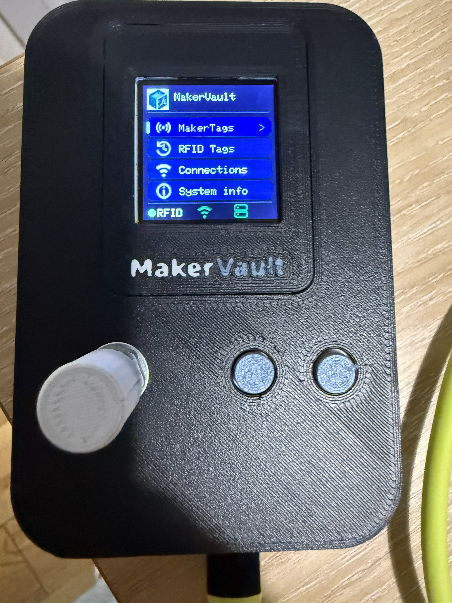
*The ESP32-S3 handheld in its printed enclosure; the rear-mounted antenna reads tags brought near the device.*

## What currently works — and what does not

The v0.7 handheld supports Wi-Fi provisioning, certificate-verified HTTPS, pairing, heartbeat, local UID scanning and online MakerTag lookup/registration/reassignment with user confirmation. NTAG215 NFC URL writing is supported after confirmation and verification; Creality CFS payload decoding remains outside this firmware's scope.

## 1. Prepare MakerVault HTTPS

Pairing requires HTTPS in both your browser and the terminal. Navigate to **Settings → HTTPS & certificates**. Use your existing valid reverse-proxy TLS setup, a publicly trusted server certificate, or MakerVault's native HTTPS and Local CA.

For MakerVault's native private CA, use **Download MakerVault Local CA** to obtain the **public** CA certificate; never export or upload its private key. The terminal requires that public CA when the server is not signed by a publicly trusted authority. Make sure the server hostname or IP used by the terminal appears in its certificate's **Subject Alternative Names (SAN)**. A valid CA alone is not enough if the name mismatches.

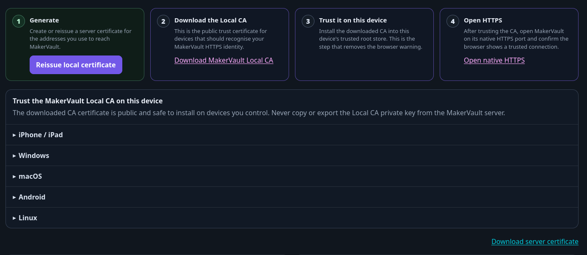
*The public MakerVault Local CA can be downloaded from HTTPS & certificates.*

The terminal's local phone setup page is served over **HTTP on the LAN**; MakerVault API access requires certificate-verified **HTTPS**. Use the phone setup page only on a trusted local network; do not port-forward it to the internet.

## 2. Configure the handheld's Wi-Fi

The handheld has an ESP32-S3 SuperMini, a **128×128 ST7735S TFT**, RC522 reader, left rotary encoder and separate Confirm/Back buttons. Rotate the encoder to move or scroll, press **Confirm** (or the encoder when appropriate) to select, and **Back** to cancel.

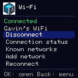
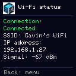
*On-device Wi-Fi options and current IP/signal information.*

The device uses **2.4 GHz Wi-Fi**. On first power-on without an existing saved network, it can start a temporary password-protected setup access point, with SSID similar to `MakerVault-XXXX`.

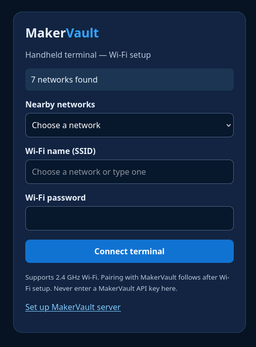
*The local setup portal lets users select a 2.4 GHz network.*

1. Scan the on-device setup QR with a phone, join the temporary network and open `http://192.168.4.1` if the page does not appear automatically.
2. Choose a nearby network or enter its SSID, enter the password and select **Connect terminal**.
3. On an already connected handheld, navigate to **Connections → MakerVault → Server setup** to open the **LAN QR** configuration page on your phone; the page is `http://<terminal-ip>/makervault`.
4. Under **Connections → Wi-Fi → Connection status**, check the SSID, IP address and signal level. Use **Known networks** to connect to or explicitly remove saved networks.

Disconnecting Wi-Fi does not delete its saved credentials. The terminal attempts to recover from unexpected outages using its remembered networks.

## 3. Set MakerVault URL and certificate trust

On the handheld, navigate to **Connections → MakerVault → Server setup**, scan its QR and open the configuration page on a phone on the same LAN.

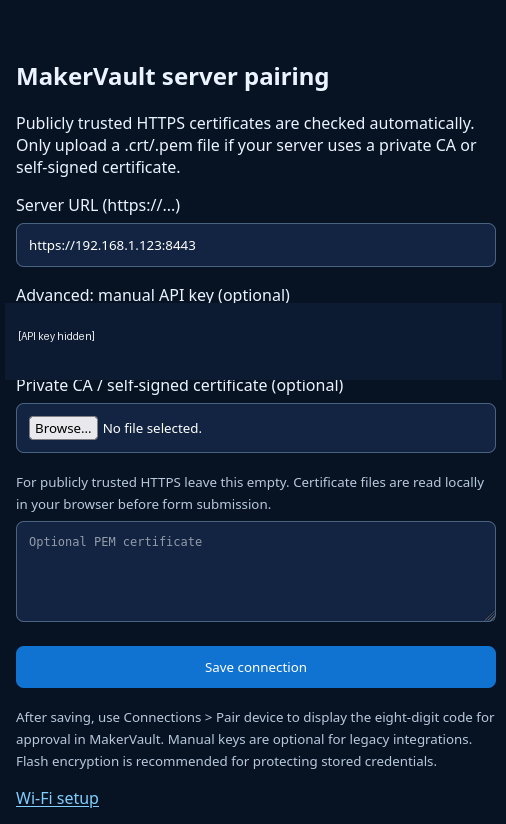
*MakerVault URL and private CA setup. The advanced API-key field is redacted.*

Enter your MakerVault **HTTPS server URL**, including the correct port if required (for example `https://maker.example.test:8443`). For a public CA-signed certificate, leave the custom CA empty to use the built-in public CA bundle. For a private MakerVault Local CA, upload its public `.crt`/`.pem` certificate or paste its complete PEM text, then choose **Save connection**. The **Advanced manual API key** field is for compatibility scenarios; normal users should leave it blank and pair with the short code.

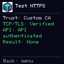
*The on-device diagnostics separate TLS trust from API authentication.*

Run **Connections → MakerVault → Test HTTPS**. It distinguishes certificate/transport verification from API authentication: a **Verified** TLS result with HTTP 401 or **Authentication failed** can be normal before pairing, whereas **Certificate rejected** means you must correct the CA, hostname, expiry or certificate chain. Do not disable certificate verification.

The v0.7 firmware retains its API key across ordinary server-address and custom-CA changes, but has an approved-endpoint guard: it must not send an existing credential to an unapproved replacement URL. Restoring the previously approved URL restores use of the saved credential if not revoked. It does not provide a complete multi-server profile manager.

## 4. Pair the handheld securely

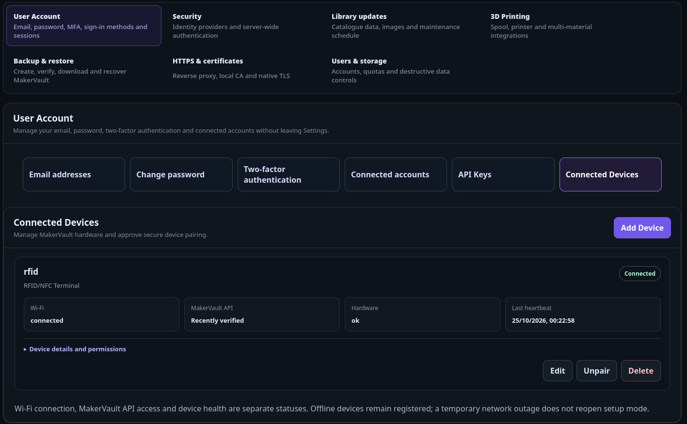
*Connected Devices is found under Settings → User Account.*

1. In MakerVault, open **Settings → User Account → Connected Devices → Add Device**.
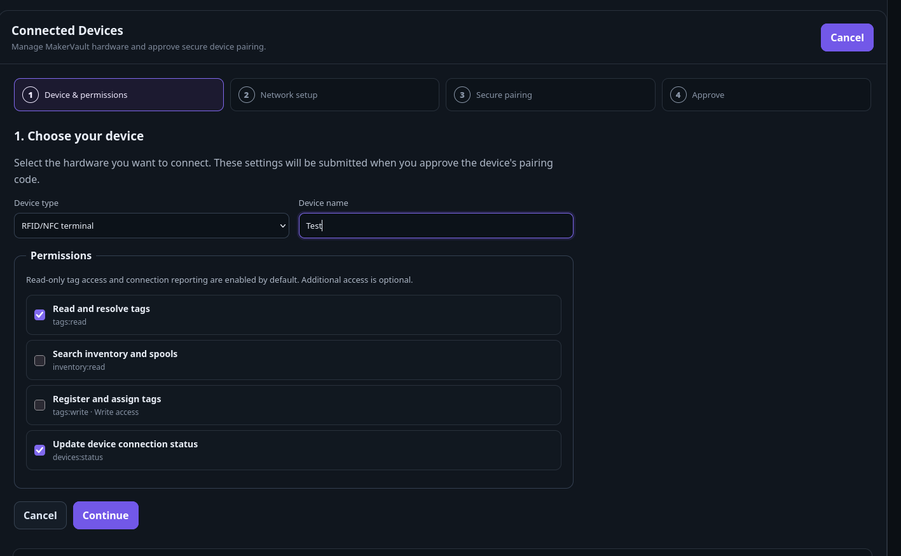

2. **Device & permissions:** choose **RFID/NFC terminal**, give it a descriptive name and select only the needed scopes. Typical read-only use needs **Read and resolve tags** (`tags:read`) and **Update device connection status** (`devices:status`). Inventory search (`inventory:read`) and tag registration (`tags:write`) are optional permission grants, **not proof of current firmware functionality**.
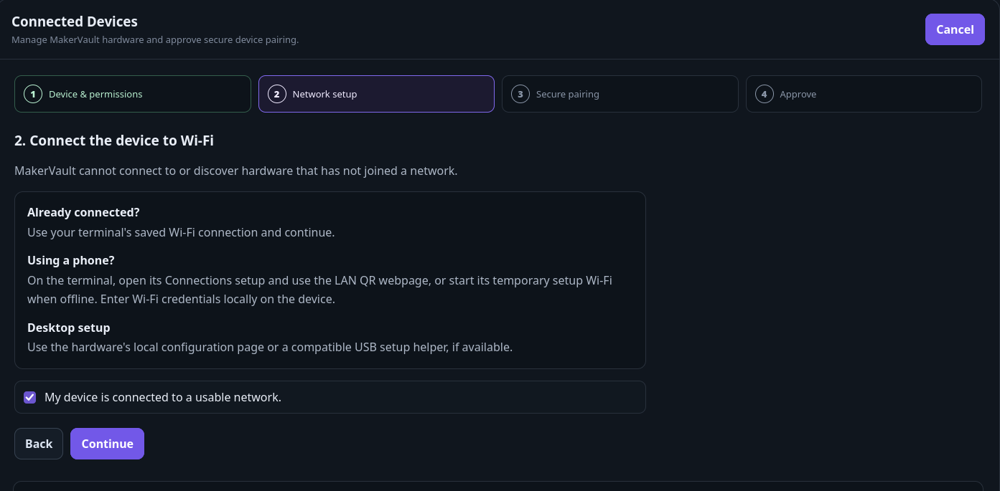

3. **Network setup:** connect the terminal to Wi-Fi and confirm it is on a usable network.
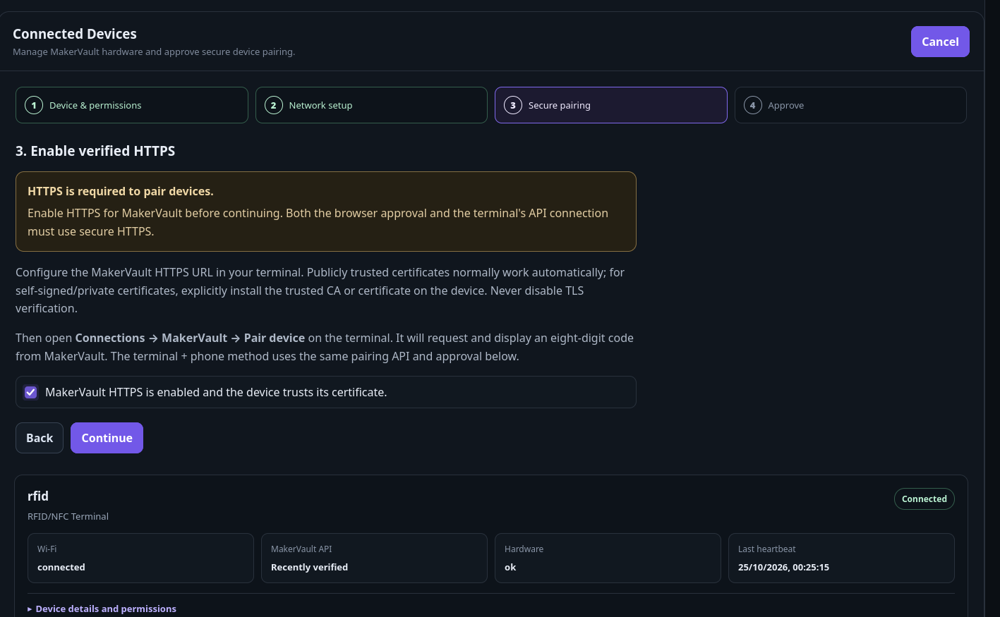

4. **Secure pairing:** confirm MakerVault HTTPS is enabled and the terminal trusts its certificate.
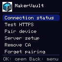
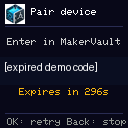
*The temporary code is generated by MakerVault and expires after five minutes.*

5. On the handheld select **Connections → MakerVault → Pair device**. It requests and displays an **eight-digit code** labelled *Enter in MakerVault*.
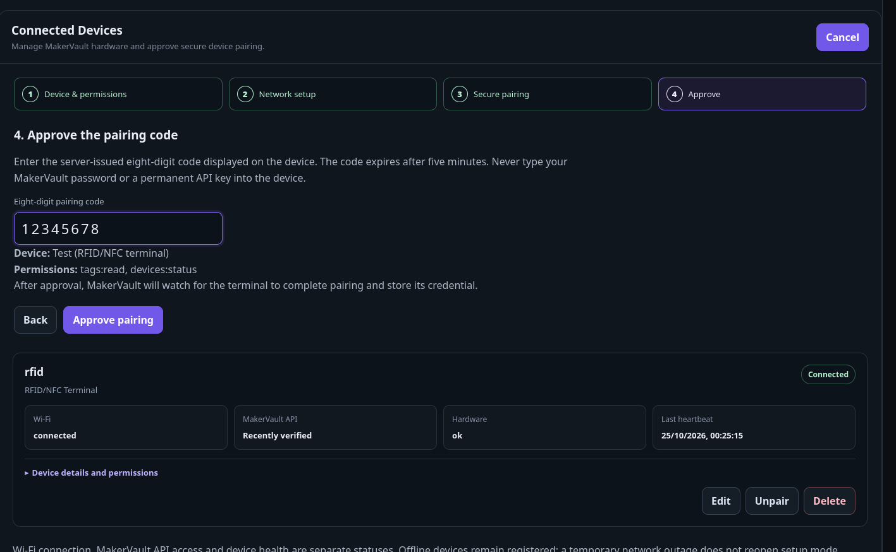

6. **Approve:** enter that code in the browser wizard, verify the selected device and permission summary, then select **Approve pairing**. The code expires after **five minutes**.
7. The handheld polls for approval, stores its one-time API credential and verifies it through `/api/device/v1/me/`. Successful pairing displays **Connected! / MakerVault ready**.

Do not enter your MakerVault login password or a long-lived API key as the eight-digit pairing code. If a code expires or is rejected, start a fresh pairing attempt on the handheld.

## 5. Everyday status, permissions and management

The **Connected Devices** list displays each device separately, with **Connected/Offline**, **Wi-Fi**, **MakerVault API**, **Hardware** and **Last heartbeat** indicators. With the panel visible, it refreshes approximately **every 30 seconds** without reloading the entire Settings page; the server considers a heartbeat recent for about **three minutes**.

These statuses are deliberately independent. Wi-Fi can remain connected when the API is unreachable; an **Offline** device can remain paired and registered. The heartbeat records recent authenticated communication, not independent proof of working RFID hardware.

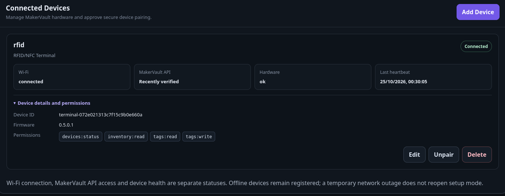
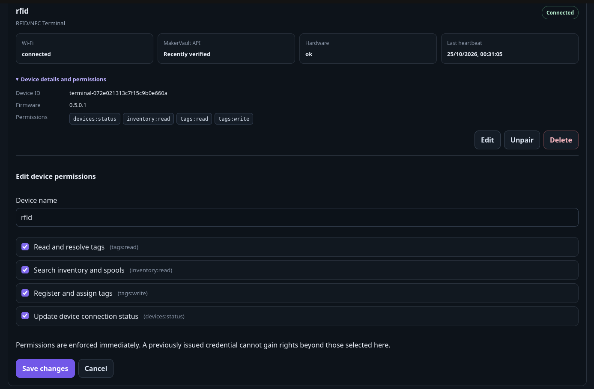
*Device details and permission scopes can be inspected and updated after pairing.*

Expand **Device details and permissions** to inspect the reported firmware, device ID and scopes. Select **Edit** to change the name or permissions. Server-side permission changes are enforced immediately, and the terminal can refresh its effective permissions from the authenticated API.

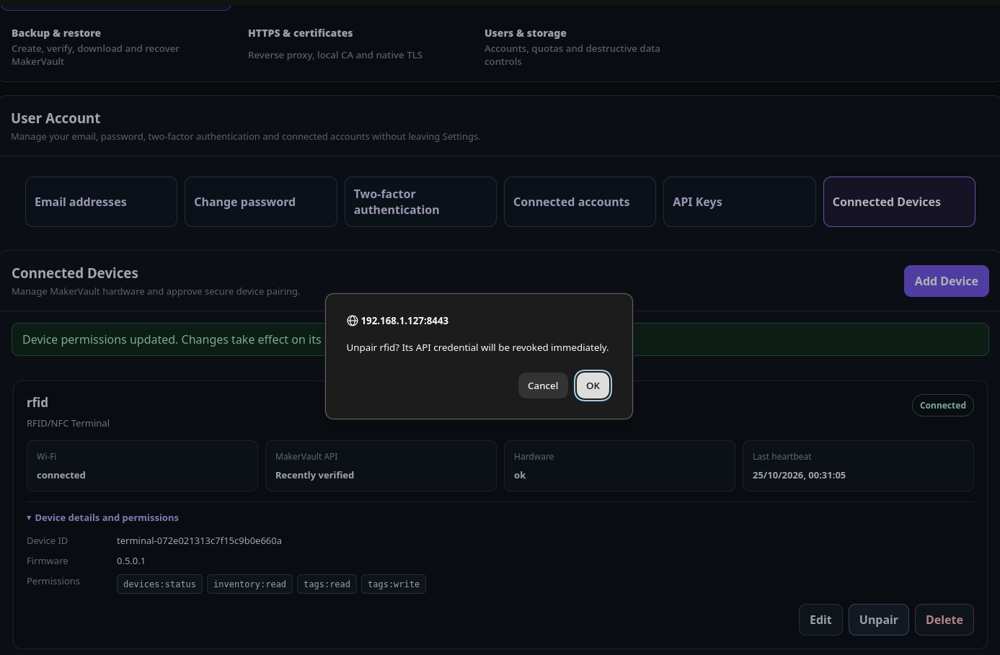
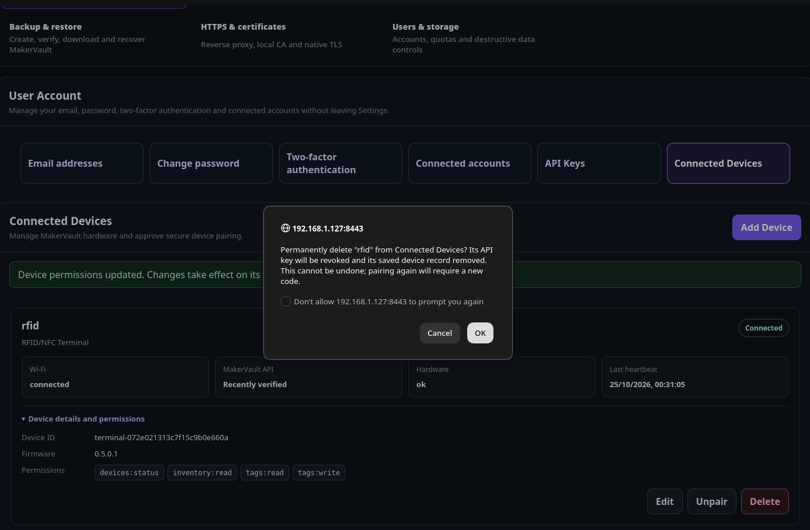
*These two actions are intentionally different; read the confirmation before proceeding.*

- **Unpair** revokes its server-side credential but leaves the saved device record.
- **Delete** revokes the credential and permanently removes its saved device record.
- On the handheld, **Connections → MakerVault → Forget pairing** deletes *local* pairing credentials; it **does not revoke the credential on the MakerVault server**. Use the MakerVault web interface to revoke access when a terminal is lost or retired.
- **Connections → MakerVault → Remove CA** deletes only the custom CA and returns to public CA trust; it does not delete saved API credentials or Wi-Fi networks.

## 6. Scan tags

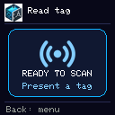
*The tested firmware detects physical tags and displays their UID; it does not resolve MakerVault records yet.*

From the handheld home screen, select **MakerTags** or **RFID Tags**, then the respective scan action. Present a compatible tag near the reader at the back of the enclosure. The firmware reports the **UID and detected tag type**. Tested tag families include MIFARE Classic 1 KB and NTAG215 UID detection.

**UID scanning works offline.** Online record resolution, registration, and NTAG215 URL writing require a paired, reachable MakerVault server. Creality CFS filament contents are not decoded by this firmware.

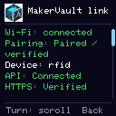
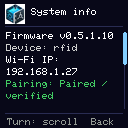
*Status and system-information screens; firmware version labels may be stale on the tested release candidate.*

## 7. Maintenance and security notes

The terminal saves Wi-Fi networks and pairing data in ESP32 nonvolatile storage. Ordinary power cycles and firmware uploads preserving NVS retain them. A network interruption, wrong CA or bad hostname should not itself erase a stored credential. The credential is scoped by MakerVault and should be revoked in the browser if the device is lost.

NVS persistence does **not** establish hardware-backed encryption at rest; production flash encryption has **not** been verified. A full factory-reset menu and OTA updates also have **not** been confirmed in this release candidate. Updates currently use Arduino IDE/USB-C with appropriate ESP32-S3 board and partition configuration.

The v0.7 firmware has been flashed and the version display verified on physical hardware.

## 8. Troubleshooting

| Symptom | What to check |
|---|---|
| Cannot join Wi-Fi | Check 2.4 GHz compatibility, SSID/password and signal |
| Server unreachable or DNS failure | Verify the server URL, DNS, network access and HTTPS port |
| **Certificate rejected** | Import the correct public Local CA or use a valid public certificate; verify SAN hostname/IP and dates |
| `HTTPClient -1` | This is a client-side failure, **not** HTTP status -1; inspect **Test HTTPS** TLS details |
| mbedTLS `-0x2700` | X.509 verification failed; inspect trust chain, hostname and expiry |
| TLS Verified but API 401 | Check whether the terminal is paired, has its original credential and uses the approved endpoint |
| API 403 | Check permission scopes and whether the operation is supported |
| Pairing code invalid/expired | Obtain a fresh eight-digit code and approve within five minutes |
| MakerVault shows Offline | Look at last heartbeat; check Wi-Fi, trust, API auth and heartbeat permissions |
| Scan sees a UID but no MakerVault record | Check HTTPS, pairing, reader permissions and whether the UID is registered |

For firmware, wiring and build-specific details, see [MakerVault-Hardware](https://github.com/gavrd7/MakerVault-Hardware). The API contract lives in the MakerVault application repository's `docs/CONNECTED_DEVICES_PAIRING.md`.

## Illustration assets

The 22 accompanying screenshots are committed under `docs/guide/assets/screenshots/connected-devices/`, including the four-step pairing wizard, mobile setup screens and handheld menus. Sensitive API-key, pairing-code and LAN QR details were obscured in the prepared publication images. Review the final rendered images before publishing.

## Connected MakerTag operations (v1.4.5)

With MakerVault [PR #150](https://github.com/gavrd7/MakerVault/pull/150) and MakerVault-Hardware [PR #6](https://github.com/gavrd7/MakerVault-Hardware/pull/6), a paired terminal can resolve MakerTags, receive browser-initiated registration requests and explicitly reassign a reusable tag to a different inventory item or spool. The user must confirm on the handheld, and reassignment asks for **a second confirmation**. The existing MakerVault ID and physical UID remain unchanged and the assignment history records the change.

Grant `tags:read` for lookup and `tags:write` for browser-initiated registration, subject to the user's MakerTag permissions. Requests are sent only to the selected paired terminal over certificate-verified HTTPS. The browser and handheld can cancel one another's pending request, and a browser refresh can resume an active registration. See [MakerTags — connected terminal workflows](maker-tags.md#connected-rfid-terminal-workflows-v140) for the step-by-step instructions.

**Release distinction:** the published v1.3.0 Connected Devices feature and released handheld baseline do not automatically include these draft additions. The hardware branch's Arduino sketch is called `MakerVault_Terminal_Firmware.ino`, inside the matching `MakerVault_Terminal_Firmware` folder. No NDEF or RFID memory writing is implemented.

## NTAG215 MakerTag writing (v0.7)

1. Pair the MakerVault Terminal over certificate-validated HTTPS and grant its scoped tag permissions.
2. In **MakerTags**, choose **Add MakerTag**, select a record and **Use MakerVault Terminal**.
3. Review the HTTPS origin (including port) and optional override, then present a compatible NTAG215.
4. Review any existing assignment and press **Confirm** once on the terminal; keep the same tag at the reader while it inspects, writes and verifies the NFC URL.
5. Wait for **MakerTag ready**, then scan with a phone. The `/t/MV-XXXXXXXX/` link opens the currently assigned record and stays constant if reassigned.

The terminal checks the UID, memory capability/locks and server authorisation before writing. Cancelled or expired write requests cannot be resumed. If an assignment completes but NFC verification fails, the app shows incomplete NFC status rather than asserting that a URL was written. MIFARE Classic and Creality CFS tags are supported for UID-based lookup without modifying their existing data.
