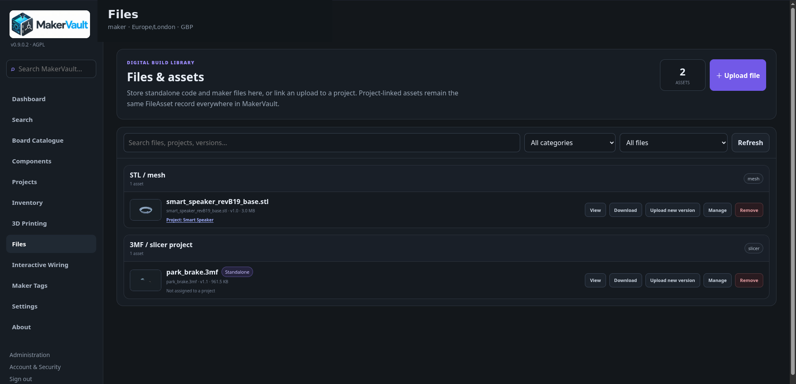

# Files, images and versions

**Files** is the central library for both project-linked and standalone uploads. Typical assets include source code, firmware, diagrams, documents, CAD, STL, 3MF, archives and binaries.

## Upload and organise

1. Open **Files** and use its upload control.
2. Select the file, give it a useful name/category and choose a project if appropriate.
3. Save, then find the item in the list.
4. Open its available preview or download it to check the upload.

A file can remain standalone. Attach or detach a project later without uploading another copy. Model files can also be linked to model revisions.

## G-code library and XY inspection

Plain-text `.gcode` is a first-class Files asset. Upload it standalone or link it to a project and model revision. The **G-code viewer** offers bounded code source, machine/filament metadata where available, and top-down XY path samples. Save supported, complete edited text as a **new version**, not an overwrite. The preview is not a slicer or full simulator, and binary `.bgcode` is unsupported by the editor.

To browse a printer's storage, transfer a file or explicitly start printing, follow [G-code library and printer submission](gcode-and-print-submission.md).

## Keep earlier versions

Use **Upload new version** on an existing file when the content changes. Each new version stores new bytes; previous versions remain available in history. Normal lists show the current version.

Use meaningful notes such as `Moved USB opening 2 mm`, not just `new file`. Open version history to download an earlier revision. Old model revisions continue to refer to their original assets rather than silently switching to the newest file.

All retained versions occupy storage. Repeatedly uploading a large model can use much more space than the single current item suggests. See your storage summary and [account quotas](../administration/accounts.md).

## Image viewing

Open a supported catalogue/project image to use zoom, pan, fit/reset and fullscreen. Mouse-wheel zoom and dragging help inspect pin labels and wiring diagrams. Fullscreen requires browser support. Download the original available file if a preview is insufficient for your task.

## Privacy and downloads

Private files are served through authenticated MakerVault endpoints. Sharing the URL is not a public sharing feature: another account is not automatically entitled to download your file. Non-image assets such as firmware, archives and SVG are downloaded rather than rendered as active page content.

Private uploads are encrypted at rest. The server must retain its matching encryption key to read them. This does not remove the need for backups or protect against someone who controls the running server and its key.

## An upload failed

Check the message, your remaining quota, free host disk space and any reverse-proxy size limit. A model-analysis failure and a file-upload failure are different: a file may be stored successfully even if its geometry cannot be analysed. Do not assume increasing a single Django memory setting removes every application/proxy limit.

[Models and the 3D viewer →](models.md)

<figure markdown>
  
  <figcaption>The Files library handles standalone and project-linked assets.</figcaption>
</figure>
