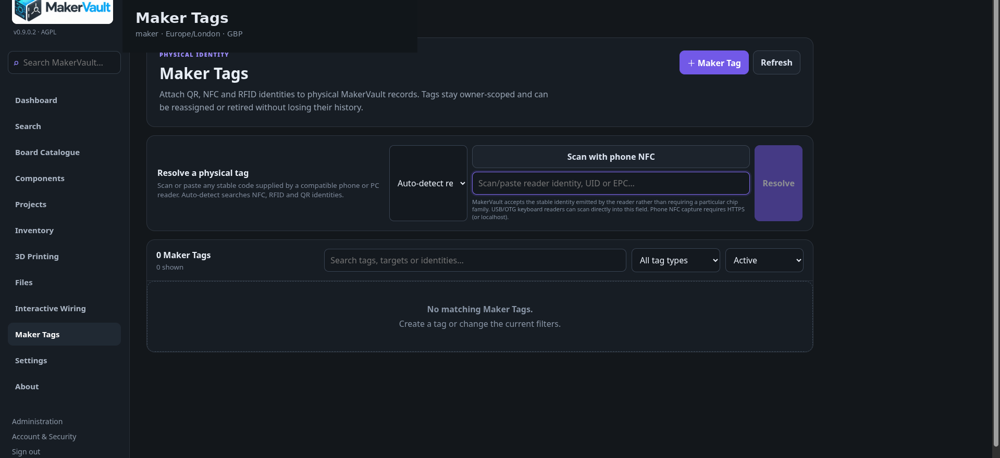

# Maker Tags

**Goal:** give a physical MakerVault record a scannable identity so you can get back to it quickly.

<figure markdown>
  
  <figcaption>Maker Tags can resolve QR, NFC and RFID identities to physical MakerVault records.</figcaption>
</figure>

Maker Tags attach a stable physical identity to an owner-scoped record. They are useful when a board, component, printed part, spool or other supported item is easier to scan than to search for manually.

## Create a tag

1. Open **Maker Tags** and choose **Add Maker Tag**.
2. Choose the physical record the tag should identify.
3. Select the appropriate tag/identity type and enter or scan the stable identity.
4. Save the tag and, for QR workflows, print the generated label where appropriate.

A tag identifies an existing MakerVault record; it does not replace the inventory ID or create a new physical item by itself.

## Resolve a tag

Use the resolver at the top of the Maker Tags page. MakerVault can auto-detect supported NFC, RFID and QR identities where the reader supplies a stable value.

USB/OTG keyboard-style readers can usually scan directly into the identity field. Phone NFC capture requires a secure browser context, normally HTTPS (or localhost), because browser NFC APIs are not exposed to arbitrary insecure pages.

## Reassign or retire

A physical label or tag can outlive the object it was first attached to. Reassign or retire it deliberately rather than silently creating a second identity for the same tag. MakerVault retains the tag history so changes remain understandable later.

Do not put secrets on a Maker Tag. Treat the QR/NFC/RFID value as an identifier, not as an authentication credential.

## Branded QR labels and reusable spool tags

Maker Tags can now target an **individual physical reusable spool**, distinct from the filament currently loaded on it. A tag remains associated with the reel as refills change, and opening the resolved identity navigates to the reusable spool record.

MakerVault's printable QR label uses a small branded centre mark. Test-scan labels after printing to verify readability at your chosen size and contrast; the logo does not alter the underlying tag identifier.

## Label layouts and batch printing (v1.2.1)

Open a QR Maker Tag and use **Label format** to preview Compact (50 × 30 mm), Standard (70 × 50 mm), Large (100 × 70 mm), or **Custom**. Custom labels let you set width, height and QR size in millimetres. Independently choose whether to show the title, tag identity code and target type. The QR scan data stays the same when resized or when label text is hidden.

For multiple labels, tick active QR tags in the Maker Tags list and choose **Print selected**, or use **Print labels** and choose all matching active QR tags. Search, status, tag type and **Target type** filters determine which tags are included. NFC/RFID-only identities and retired tags are not included in QR label batches. The selected label format and text options apply to the whole batch, arranged on A4 sheets.

Always inspect the browser print preview and print at **100% scaling** when dimensional accuracy matters. Small QR codes carrying long URLs may be difficult to scan; test one before printing a full batch. Browser and printer margins can affect positioning. QR codes identify a record, but are not authentication credentials.

## Record shortcuts and tag removal (v1.2.2)

From an eligible inventory item, project, filament spool, physical reusable spool, printer, printed part or storage/printing location, select **Maker Tags** to open an assigned tag. If none is assigned and your role permits creation, the existing Maker Tag form opens with the current target preselected. Closing the tag view or creation form returns to the originating record.

Use **Delete** from the Maker Tags list or tag details to permanently remove a tag if you have deletion permission. Confirm carefully: the MakerVault record and its history are removed and its scan link no longer resolves. This does **not** erase a physical NFC/RFID chip or the separate filament spool RFID UID. Use **Retire** instead when preserving identity history is important.

The main sidebar also links directly to **Model Library**, which remains accessible from **3D Printing**. The 3D Printing overview lists a few storage/printing locations and offers **View all**, **Maker Tags**, **Edit** and **Delete** actions as permitted.
