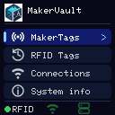
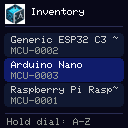
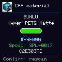

# Terminal interoperability (v1.5)

MakerVault v1.5 connects compatible MakerVault Terminal firmware to the filament and physical-spool workflows. All operations remain self-hosted. The terminal uses its paired HTTPS connection and individually scoped permissions.

## Terminal screens

<figure markdown>
  { width="320" }
  <figcaption>The v1.0 terminal home screen. MakerTags and generic RFID reading are separate workflows.</figcaption>
</figure>

<figure markdown>
  { width="320" }
  <figcaption>The on-device inventory browser displays record names and stable MakerVault IDs.</figcaption>
</figure>

<figure markdown>
  { width="320" }
  <figcaption>Hold the encoder in the inventory browser to jump alphabetically without an on-screen keyboard.</figcaption>
</figure>

## CFS material reading

The terminal decodes supported Creality CFS RFID material IDs, colour HEX values and UIDs directly from the tag. When connected, MakerVault resolves a material ID against its saved read-only Creality printer material database snapshot. This returns material name and manufacturer; no printer update or filament library import is performed.

<figure markdown>
  { width="320" }
  <figcaption>Read-only CFS scan: material details and a spool link resolved from the physical RFID UID.</figcaption>
</figure>

To obtain a material snapshot:

1. Configure a Creality local printer connection under **3D Printing**.
2. Open **Settings → 3D Printing → Creality printer material databases**.
3. Select the printer, enter the SSH username and password, and **Detect host key**. Independently confirm the fingerprint before accepting it.
4. Choose **Sync from printer now**. Daily read-only sync is optional and disabled by default.
5. Scan a compatible CFS tag with a paired terminal granted `inventory:read`.

A database sync stores an exact validated JSON copy. It does not write to the printer, create filament products or automatically bind a material to a physical spool.

## Link a physical spool by RFID

Material names and colours identify a product, **not a particular physical reel**.

1. Open **3D Printing → Spool Inventory**, choose the correct spool and open **RFID identity**.
2. Choose **1 tag** or **2 tags (one on each side)**. Existing spools retain their original RFID ID as Tag 1.
3. Enter either tag UID manually, or choose a paired terminal and select **Scan into Tag 1** or **Scan into Tag 2** as appropriate.
4. Present the corresponding tag to the terminal. Repeat for the second tag if selected. Scanning only fills the selected field; it is **not yet saved**.
5. Verify that both tags belong to the same physical reel and have different UIDs, then select **Save RFID identity**.
6. Scanning either side of the reel now resolves to the **same** MakerVault spool ID.

The browser-assisted scan is read-only and requires a paired terminal with `tags:read`. It never writes the third-party tag or assigns an inventory spool automatically. A physical UID can only belong to one MakerVault spool, including across primary and secondary tag slots. Selecting one tag and saving clears the optional second identity.

## Offline and experimental RFID

With no Wi-Fi, a compatible CFS tag can still show its decoded material ID, UID and HEX colour/swatches. Full material names and spool associations require a trusted MakerVault connection; missing information is not guessed.

Bambu Lab and Elegoo are **experimental read-only compatibility targets**, not universal decoding guarantees. Their protected/tag-specific layouts may allow UID-only identification until supported data has been read and validated. MakerVault Terminal does not write third-party filament RFID tags.

See [Connected Devices](connected-devices.md), [MakerTags](maker-tags.md) and the [terminal hardware repository](https://github.com/gavrd7/MakerVault-Hardware).

## Safety and troubleshooting

- **Unknown material:** Check that the tag material ID exists in a successfully synchronised printer database snapshot.
- **Spool not linked:** Confirm that this exact physical tag UID has been saved on the correct spool.
- **Lookup unavailable:** Verify terminal Wi-Fi, MakerVault HTTPS trust, pairing and `inventory:read` permission.
- **SSH host verification failed:** Do not bypass the fingerprint check. Recheck the printer's trusted public host key.
- **Read-only:** No tag writing, printer material database pushing, implicit product creation or material-only spool matching occurs in these workflows.

## Third-party experimental tags (Terminal v1.0)

The terminal's generic **RFID Tags** reader also includes experimental Bambu Lab MIFARE Classic and Elegoo NTAG field readers. These use published formats to display only decoded fields: material, colour, and where supported, weight and diameter. **Neither implementation has been tested using an actual manufacturer tag.** The automated tests use synthetic documented-format fixtures and do not establish physical compatibility. Protected, unfamiliar or unsupported tags fall back to UID-only scanning; no third-party tag is written or automatically linked to a spool.

The Bambu reader uses community-described per-UID Key A authentication, while the Elegoo reader accepts only a narrow manufacturer-marked, plain-text NTAG layout. Displayed results are informational and are not proof of genuineness or manufacturer authenticity.

See the [hardware repository experimental RFID notes](https://github.com/gavrd7/MakerVault-Hardware/blob/main/docs/terminal-third-party-rfid.md) for format limits and validation status.
